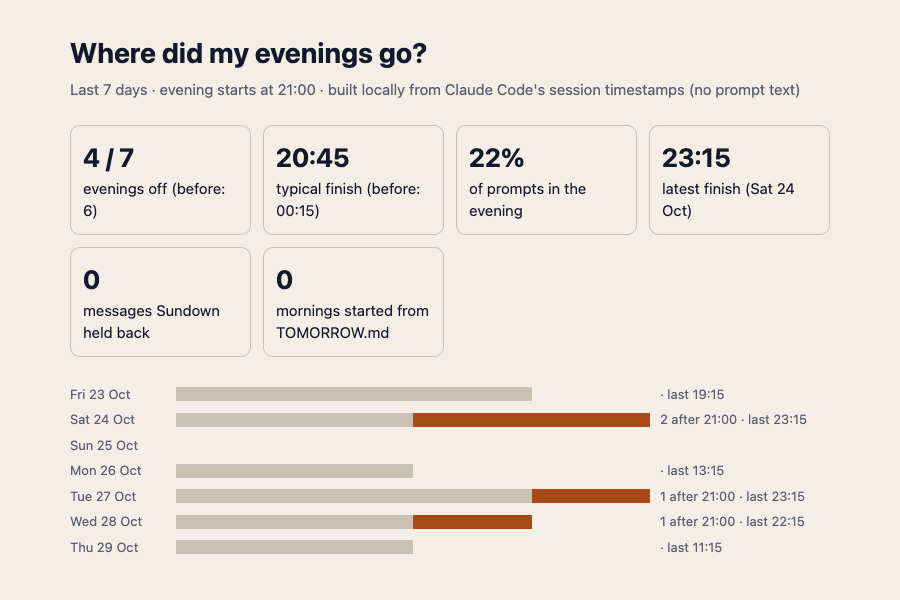

# Sundown

[](https://github.com/eugeniobusta/sundown/actions/workflows/test.yml)

**A Claude Code plugin that gives your evenings back.**

## In 30 seconds

```
/plugin marketplace add eugeniobusta/sundown
/plugin install sundown@sundown
```

Restart Claude Code, then run `/sundown:setup` and choose your evening cutoff. From then on, "one more prompt" after your cutoff is held back; `/sundown:shutdown` ends the day, writes a three-line `TOMORROW.md` and stops your agents; the next morning your first session opens with that note. It needs Node.js 18 or newer and nothing else. Everything stays on your machine unless you turn on phone pushes.

## The problem: compression burnout

AI coding tools made each task faster, and the day got longer anyway. The time AI saves doesn't come back to you; it gets filled with more work. There is always one more prompt, and an agent is always still running, so the evening quietly becomes part of the workday. That's **compression burnout**: the same pressure, packed into more hours.

**Who it's for:** developers who use Claude Code every day and keep finding themselves at the terminal at 22:00, "just finishing one thing."

**What it is:** the *shutdown command*: one command that writes tomorrow's first step down and pauses your agents until morning. It saves *where you stopped*, as a three-line note; it doesn't commit or stash your code. Around it sits the rest of the evening, and a report that shows whether the time went back to you. Optionally, Claude can also "dream" at shutdown: propose a tidy-up of its own memory for you to review (off by default; see Dreaming).

## What it does

Sundown builds the end of the day into Claude Code:

- **After your cutoff, new prompts are held back.** You can still send one with `override:`, and every override shows up in your report.
- **`/sundown:shutdown` ends the day.** Any agent still running is stopped at its next tool call (that call is refused too) after it writes a three-line handoff to `TOMORROW.md`.
- **Shutdown can also dream** (optional, off by default; turn it on with `sundown config dream on`). Before the handoff, Claude reads its memory of your project and writes `DREAM.md`: a proposed tidy-up, with duplicates merged, stale notes replaced and new lessons added. Nothing is changed that night. In the morning you read it and run `/sundown:dream apply` or `/sundown:dream discard`. See [Dreaming](#dreaming) below.
- **A heads-up before your cutoff** (optional, off by default). With `sundown config wrapUpMinutes 30`, one short note says half an hour before your cutoff that it's a good moment to land the task. Claude is told the same thing, so it doesn't start anything big. Once a day, never more.
- **Days off stay off** (optional). Choose days such as `sat,sun` and Sundown keeps them quiet from morning to morning.
- **The next morning,** your first session opens with that handoff, so you start in two minutes instead of twenty.
- **You can leave the desk while an agent runs** (optional). Instead of watching the terminal, you get one phone push when Claude needs you or finishes a long task. It's off by default, and short turns never send anything.
- **`/sundown:report`** shows whether your evenings are coming back: evenings off, your typical (median) finish time, both compared with the week before, and how many mornings started from a handoff. Built locally from Claude Code's session timestamps.

It adds no work to your day: nothing to fill in, and nothing to check. It stays out of the way until the evening, then makes stopping the default.

Sundown doesn't help you do more. It helps you stop.

## What it looks like

These are the real messages, produced by the plugin's own scripts.

**Half an hour before your cutoff**, if you turned on the optional wrap-up note (once a day, and your message still goes through):
```
◐ Sundown: 20 min to your 21:00 cutoff. A good moment to land this task; /sundown:shutdown saves tomorrow's first step.
```

**After the cutoff**, a new message is held back:
```
☾ Sundown: it's after your 21:00 cutoff (until 08:00).
Really need this now? Start the message with "override:". Working early? Run /sundown:wake.
```

**The next morning**, your first session opens with the handoff Claude wrote when you shut down:
```
☀ Good morning. Last time you stopped here:
Stopped at: cart.py: total() ignores discount codes (TODO), tax() has a hardcoded 0.2 rate (FIXME)
First step tomorrow: decide the format of discounts.json, then apply it in total()
Open question: where should per-region tax rates come from?
```

**The status line** (optional) counts down in the corner of Claude Code: `☀ 9h 00m to sundown (21:00)`, then (if you turned on the optional wrap-up note) `◐ 15m to sundown · time to wrap up`, then `☾ After sundown · "override:" to send`.

**`/sundown:report`** also writes a page you can open (it follows your light or dark setting). This one uses made-up data:



## Dreaming

**What it is.** In May 2026 Anthropic introduced *dreaming* for Claude Managed Agents (research preview). Agents write to their memory as they work, in small local steps, so over many sessions the memory collects duplicates, contradictions and stale notes. A *dream* is a separate pass between sessions: Claude reads the memory and past sessions, then produces a cleaned-up memory (duplicates merged, stale or contradicted entries replaced, new insights surfaced). The original is never touched, so you can review the result and throw it away. ([Anthropic's docs](https://platform.claude.com/docs/en/managed-agents/dreams))

**What Sundown does with it.** Anthropic's feature is an API for Managed Agents: it works on cloud memory stores and API sessions, needs an API key and approved access, and cannot see your Claude Code sessions or the memory files Claude Code keeps on your disk. So Sundown doesn't call it. It builds the same idea locally, inside the shutdown you already run: *propose, never apply, you decide*.

**What happens, step by step.**

1. You run `/sundown:shutdown`. The shutdown lock turns on, as before.
2. **The dream.** If you turned `dream` on, Claude reads (only reads) its memory for this project (`MEMORY.md` and the files it lists) and the project's `CLAUDE.md`, compares them with what happened in this session, and writes `DREAM.md` in the project root with up to 12 proposals under three headings: **Merge** (duplicates), **Update** (an old note, quoted exactly, and its replacement, with the reason) and **New** (a lesson, preference or workaround from this session, and where it belongs). If it finds nothing worth changing, it says so. Any dream instructions you saved with `dreamInstructions` steer what it focuses on and what it leaves alone.
3. **The handoff.** Claude then writes `TOMORROW.md` as before. This comes last because writing it ends the session.
4. **Nothing is changed that night.** During shutdown the only files Claude can write are `DREAM.md` and `TOMORROW.md`, enforced by the same hook that stops your agents. It can't edit a memory file even if it tried, so the dream can only propose.
5. **The next morning**, your first session says "Last night's dream is in DREAM.md" next to your handoff. The text of the dream is not pasted into the session; you open and read it first.
6. **You decide.** `/sundown:dream` summarises it; `/sundown:dream apply` makes the changes one by one (skipping any it can't match, and anything that looks like an instruction, a secret or a token), tells you what changed and deletes `DREAM.md`; `/sundown:dream discard` just deletes it. Dream files older than four days are not mentioned.

**What it does not do.** It reads this session and Claude's memory, not your old transcripts: Sundown's own code never reads session text (see Privacy). It makes no extra network calls and no separate model run; the dream is a few more steps in the shutdown turn you already run, so it uses some of your normal Claude Code usage. It isn't a copy of Anthropic's hosted pipeline (no 100-session batches, no new memory store), and quality depends on Claude following the skill. Check `DREAM.md` before applying.

**Turn it on, off or steer it.** It is off until you turn it on, so a fresh install adds nothing to your shutdown or your morning.

```
sundown config dream on                                    # dream at shutdown
sundown config dream off                                   # back to no dream (the default)
sundown config dreamInstructions "focus on coding-style preferences; ignore one-off debugging notes"
sundown config dreamInstructions off                       # remove the steering
```

Try it without waiting for the evening: follow "Try it in a minute", run `/sundown:shutdown` in step 3 and look for `DREAM.md` next to `TOMORROW.md`, then start the "next morning" session and run `/sundown:dream`.

## Install

```
/plugin marketplace add eugeniobusta/sundown
/plugin install sundown@sundown
```

Restart Claude Code (or run `/reload-plugins`), then run `/sundown:setup`. Your first session after installing reminds you. Until you choose a cutoff, Sundown never blocks anything; only `/sundown:shutdown` does.

Requirements: Claude Code with plugin support, and Node.js 18 or newer on your PATH (check with `node --version`; the native Claude Code installer does not include it). Nothing to `npm install`: Sundown has no dependencies.

## Uninstall

```
/plugin uninstall sundown@sundown
/plugin marketplace remove sundown
```

That removes the hooks and commands. Sundown's own files are small and stay until you delete them: the settings and history in `~/.sundown/`, and any `TOMORROW.md` notes it wrote in your projects. If you added the status line, `sundown install-statusline` saved your previous settings as `~/.claude/settings.json.sundown-backup`; restore it, or delete the `statusLine` entry from `~/.claude/settings.json`.

## Try it in a minute (no need to wait for the evening)

`SUNDOWN_NOW` fakes the clock and `SUNDOWN_DIR` uses a throwaway settings folder, so this doesn't touch your real setup. After installing, in a terminal inside any project:

```
export SUNDOWN_DIR="$(mktemp -d)"
echo '{"cutoff":"21:00","morning":"08:00"}' > "$SUNDOWN_DIR/config.json"
SUNDOWN_NOW=2026-10-29T22:00:00 claude
```

1. Type `hello`. It's held back: *"☾ Sundown: it's after your 21:00 cutoff…"*
2. Type `override: say hi`. It goes through, and is counted in the report.
3. Type `/sundown:shutdown`. Claude writes `DREAM.md` (proposed memory changes), then `TOMORROW.md` (three lines), and stops. Exit Claude Code.
4. "Next morning": `SUNDOWN_NOW=2026-10-30T08:30:00 claude`. The session opens with *"☀ Good morning. Last time you stopped here: …"* and, if a dream was written, *"☾ Last night's dream is in DREAM.md…"*. Run `/sundown:dream` to read it.
5. Run `/sundown:report` to see the override and the held-back message.

To see the optional wrap-up note instead, run `sundown config wrapUpMinutes 30`, start at `SUNDOWN_NOW=2026-10-29T20:40:00` and send any message.

## Commands

| Command | What it does |
|---|---|
| `/sundown:setup` | Choose your cutoff, morning time and days off, connect your phone (optional), add the countdown to the status line (optional). |
| `/sundown:shutdown` | End the day now. Writes `TOMORROW.md` and pauses Claude Code until your morning time. |
| `/sundown:dream` | Show last night's dream (`DREAM.md`). `/sundown:dream apply` makes its proposed changes to Claude's memory and deletes it; `/sundown:dream discard` deletes it and changes nothing. |
| `/sundown:wake` | Switch Sundown off until your next cutoff (working early, or a mistake). |
| `/sundown:status` | Is Sundown on, and how long until your cutoff? |
| `/sundown:report` | Your last 7 days: evenings worked, typical (median) and latest finish (compared with the week before), days off kept, mornings started from a handoff, prompts held back, overrides. Also writes `~/.sundown/report.html`. |
| `override: <message>` | Send one message anyway. That session keeps working for 20 minutes (configurable). |

The same things work from a terminal: `node <plugin folder>/bin/sundown status | shutdown | wake | config | report | dream clear | test-push`.

Settings (`sundown config <key> <value>`, or ask `/sundown:setup`):

| Setting | Default | Meaning |
|---|---|---|
| `cutoff` | off | When your evening starts, e.g. `21:00`. `off` = only `/sundown:shutdown` ends the day. |
| `morning` | `08:00` | When the day starts again. |
| `daysOff` | none | Whole days kept quiet, e.g. `sat,sun`. `off` = none. A day off runs from that morning to the next, so with `fri,sat` Thursday evening locks at your cutoff and unlocks on Sunday morning. |
| `wrapUpMinutes` | `off` | Optional: one "time to wrap up" note this many minutes before the cutoff, e.g. `30`. Off by default, so a fresh install shows you no alerts. |
| `overrideMinutes` | `20` | How long one `override:` lets that session keep working. |
| `dream` | `off` | Optional: `on` = `/sundown:shutdown` also writes `DREAM.md`, a proposed tidy-up of Claude's memory for you to review. Off by default, so shutdown and your morning stay as short as they were. |
| `dreamInstructions` | none | Optional steering for the dream, one line, up to 1000 characters, e.g. `focus on coding-style preferences`. `off` clears it. |
| `ntfyTopic` | off | Phone pushes. `generate` makes a private topic. |
| `pushDetail` | `none` | `folder` adds the project folder name to pushes. |
| `minTurnSeconds` | `60` | Only push "Claude finished" after turns at least this long. |
| `ntfyServer` | `https://ntfy.sh` | Your own ntfy server, if you have one. |

## How it works

Sundown is four small hook scripts, plus a shared library and a report builder, all plain Node with no dependencies:

| Hook | Script | Job |
|---|---|---|
| `UserPromptSubmit` | `scripts/gate.mjs` | Holds back prompts after the cutoff, on a day off or during shutdown; handles `override:`, `/sundown:shutdown` and `/sundown:wake`, and tells Claude whether to dream and with what instructions; shows the optional once-a-day wrap-up note. |
| `PreToolUse` | `scripts/pause.mjs` | During shutdown only: denies every tool call except reading files (including a short allowlist of plain read-only shell commands, listed under Security notes) and writing the project's `TOMORROW.md` and, while `dream` is on, `DREAM.md`, then, on the next tool call of any kind, stops the agent once the handoff exists. |
| `SessionStart` | `scripts/morning.mjs` | Shows yesterday's `TOMORROW.md` to you and to Claude, and points at a waiting `DREAM.md` (without pasting it); clears the lock when morning comes; points a fresh install at `/sundown:setup` once. |
| `Notification`, `Stop` | `scripts/push.mjs` | Phone pushes, only if you set a topic. |

`scripts/lib.mjs` holds the shared logic (settings, time, lock, state files), `scripts/report.mjs` builds the report, and `bin/sundown` is the command-line tool the skills call.

Shutdown and wake are handled by the hook that only runs on messages a person typed. Inside Claude's own shell (Claude Code marks it with `CLAUDECODE=1`), the command-line `sundown wake` and `sundown shutdown` refuse to run, and so does any change to `cutoff`, `morning`, `daysOff` or `overrideMinutes` that would loosen Sundown, at any hour: a later or removed cutoff, an earlier morning, fewer days off, a longer override, or (while it's on) anything that ends tonight sooner. So Claude can't switch Sundown off to keep working, tonight or tomorrow. Changes that keep or tighten it still work (a first cutoff, an earlier cutoff, a later morning, an extra day off), so `/sundown:setup` can finish at any hour, and a command it can't run is handed to you to run yourself; if Sundown is already on, your own answers to its questions need to start with `override:`.

## Privacy

- **Everything stays on your machine** in `~/.sundown/`, with owner-only permissions (folder 0700, files 0600). If the folder or `config.json` already exists with looser permissions, Sundown tightens them.
- **Your prompts are never stored.** The gate only checks whether a message starts with `override:` or `/sundown:`. The event log records the time and type of each event (blocked, override, shutdown, wake, paused, pause-requested, morning, handoff, wrapup, push), plus a small label for some of them: the reason (blocked, override), the tool's name (paused, pause-requested), and whether a push was delivered. Nothing else.
- **The dream stays on your machine too.** `DREAM.md` is a plain file in your project folder (add it to `.gitignore` if you don't want it committed: it can quote your memory notes). Sundown's code never reads session text; the dream is written by Claude, which already has this session in front of it, and from memory files Claude already reads. The event log gets one more entry type, `dream`, with no content.
- **The report reads only timestamps** from Claude Code's session logs. It never reads prompt text, answers or code into the report.
- **Phone pushes are off by default.** When you turn them on, the message says "Claude finished after 14 min" and nothing about your project. You can choose to include the project folder name (`sundown config pushDetail folder`). Code, prompts and file contents are never sent.
- **The only network call** is the push to ntfy.sh (or your own ntfy server: `sundown config ntfyServer https://your.server`).

## Security notes

- Hooks **fail open**: if a script hits an unexpected error, it lets Claude Code carry on. A bug in Sundown can't lock you out.
- **No shell is ever spawned.** Session ids are checked against `^[A-Za-z0-9_-]{1,128}$` before they're used in a file name, so a strange id can't write outside `~/.sundown`.
- **Every setting is validated**, both when you set it and when it's read, so a typo in `config.json` falls back to the default instead of breaking a hook.
- The **ntfy topic works like a password**: anyone who knows it can read and send your pushes. `sundown config ntfyTopic generate` makes a random 96-bit one. Don't share it or commit it.
- `install-statusline` edits `~/.claude/settings.json`. It keeps a backup of your original (running it again doesn't overwrite that backup), keeps every other setting, and refuses to replace a status line that isn't Sundown's unless you pass `--force`.
- The skills that run commands are limited to `Bash(sundown *)`.
- **The dream can only propose.** While the shutdown lock is on, `pause.mjs` allows writes to exactly two files, `TOMORROW.md` and (when `dream` is on) `DREAM.md`, both in the project root and neither through a symlink. Memory files, `CLAUDE.md` and everything else stay read-only until you run `/sundown:dream apply` yourself. `/sundown:dream` and `sundown dream clear` only delete a plain file called `DREAM.md` in the current folder.
- `dreamInstructions` is your text, saved on one line (no control characters, 1000 characters at most) and quoted to Claude as your preference. It steers the dream; it can't widen what the dream may write.
- During shutdown, the only shell commands allowed are on a short allowlist (`ls`, `cat`, `head`, `wc`, `pwd`, `grep`, `tail` with `-n`/`-c`/`-q`/`-v`, `find` with only its name, path, type, depth, newer, mtime, size and not/and/or tests, and `git status|log|diff|show|ls-files` without output or external-program flags, where `git diff`, `git show` and patch-style `git log` also need `--no-ext-diff --no-textconv`), optionally piped into each other. Quotes, globs, `$`, `;`, `&`, `<`, `>` and every other program are denied, so there is no way to smuggle a second command in. One caveat: a plain `git status` still runs a program if the repository's own `.git/config` sets `core.fsmonitor`. That needs a config someone already put in your own repo, so Sundown treats your repositories as trusted. When a shell command is refused, Claude is told which forms are allowed (with examples), so it retries instead of writing a blind handoff.

## Limits (be honest about them)

- **It's a commitment device, not a lock.** You can always type `override:`, run `/sundown:wake` or disable the plugin. The point is that stopping becomes the default and continuing becomes a choice you can see in your report.
- **The dream is a proposal written by a model.** It can miss things or get one wrong, and a dream is only as good as the memory and session it read. That is why nothing is applied without you. It is also not Anthropic's hosted dreaming (that is a Managed Agents API feature, in research preview, that Claude Code can't use).
- **It only covers Claude Code.** Other editors and terminals are untouched.
- **A running agent stops at its next tool call.** That call is refused, and the run is stopped. A single long command that has already started (a ten-minute build) runs to the end.
- **The handoff goes in the folder Claude Code reports as its current directory** (it follows `cd`). `TOMORROW.md` is looked for there, not in a parent folder.
- **One cutoff for every working day.** Days off can be whole days, but there's no separate cutoff per weekday yet.
- **Claude can't switch Sundown off by accident, but it isn't sandboxed.** The `CLAUDECODE` check stops `sundown wake`, `sundown shutdown`, loosening the schedule and repointing pushes (`ntfyServer`). Something deliberately written to get around it (clearing that variable, or editing `~/.sundown` directly) could. One gap by design: before you have chosen any cutoff, Claude can pick an earlier morning during first-time setup (there is no schedule to loosen yet). It's a commitment device for you, not a security boundary against Claude.
- **The report counts prompts, not hours.** It's a picture of when you were working, not a timesheet.
- `pause.mjs` starts Node on every tool call, which adds roughly 50 ms per call on a laptop (measured: 48 ms against 39 ms for an empty Node start).
- The status line points at the installed copy of the plugin. Run `sundown install-statusline` again after updating Sundown.

## Development

```
node --test test/*.test.mjs        # 84 tests, no dependencies (also run by CI on Linux and macOS, Node 18/20/22)
claude --plugin-dir .              # try the plugin without installing it
claude plugin validate --strict .
```

`demo/setup-demo.sh` prepares a throwaway demo project and state folder for showing Sundown live without touching your real settings.

`SUNDOWN_DIR` moves the state folder and `SUNDOWN_NOW` fakes the current time (both used by the tests and handy for demos):

```
SUNDOWN_NOW=2026-10-30T08:30:00 claude --plugin-dir .
```

## License

MIT
